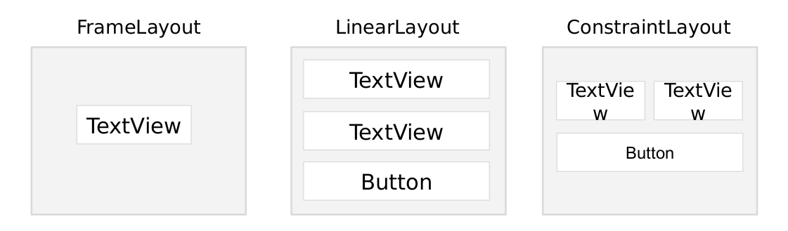
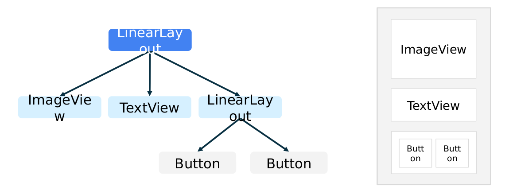
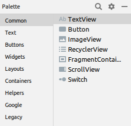

# Componentes Visuales

## Componentes visuales: XML vs Jetpack Compose

Las interfaces Android están formadas por componentes visuales.

Tradicionalmente estos componentes se denominan **Views** y se agrupan dentro de **ViewGroups**.

### Algunos ejemplos de Views

```
- TextView            - EditText
- Button              - ImageView
- CheckBox            - RadioButton
```

### Algunos ejemplos de ViewGroups

```
- LinearLayout
- ConstraintLayout
- FrameLayout
```

Todos los elementos visuales deberían encontrarse organizados dentro de algún contenedor.

## Equivalencias XML y Compose

Jetpack Compose utiliza componentes equivalentes escritos directamente en Kotlin.

| **XML**                                                                                                                      | **Compose**                                                                                             |
| ---------------------------------------------------------------------------------------------------------------------------- | ------------------------------------------------------------------------------------------------------- |
| \<TextView android:text="Hola"/>                                                                                             | <p>Text(<br>    text = "Hola"<br>)</p>                                                                  |
| \<EditText android:hint="Nombre" />                                                                                          | <p>TextField(<br>    value = nombre,<br>    onValueChange = {<br>        nombre = it<br>}<br>)</p>      |
| \<Button android:text="Aceptar"/>                                                                                            | <p>Button(<br>    onClick = { }<br>) {<br>    Text("Aceptar")<br>}</p>                                  |
| \<ImageView android:src="@drawable/logo" />                                                                                  | <p>Image(<br>    painter = painterResource(R.drawable.logo),<br>    contentDescription = null<br>)</p>  |
| \<LinearLayout android:orientation="vertical">                                                                               | <p>Column {</p><p>}</p>                                                                                 |
| \<LinearLayout android:orientation="horizontal">                                                                             | <p>Row {</p><p>}</p>                                                                                    |
| \<FrameLayout>                                                                                                               | <p>Box {</p><p>}</p>                                                                                    |
| <p>&#x3C;RecyclerView /></p><p>[RecyclerView necesita:</p><p>RecyclerView - Adapter - ViewHolder - LayoutManager</p><p>]</p> | <p>LazyColumn {</p><p>}</p><p>[LazyColumn necesita:</p><p>LazyColumn - items() - Composable</p><p>]</p> |

**Views (Vistas) y sus tipos**

Las vistas son los bloques de construcción de la interfaz de usuario en Android. Son componentes que permiten controlar la interacción del usuario con la aplicación. Estos son muy similares a los controles SWING de Java, como Labels, Buttons, TextFields, Checkboxes, etc. Los Views son organizados dentro de los Layouts para que el usuario comprenda los objetivos de la actividad.

Se pueden agrupar para formar interfaces de usuario más complejas. Un ViewGroup es un contenedor que determina cómo se muestran las vistas.

El ViewGroup es el padre y las vistas dentro de él son sus hijos. Algunos tipos de ViewGroups son:



Todos los elementos de una pantalla, deberían ir agrupados dentro de un ViewGroup.

La representación jerárquica de un ViewGroup (LinearLayout) podría ser esta:





En Android Studio encontramos todas las vistas y grupos de vistas para trabajar con XML con las que podemos interactuar en una ventana como la de la imagen derecha.

Hay multitud de variantes y opciones a la hora de crear vistas y adaptarlas a las necesidades de nuestra aplicación.
