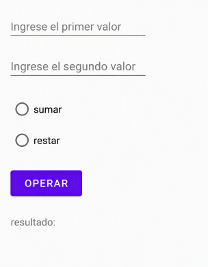
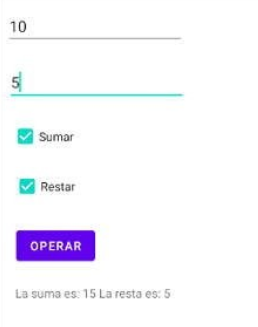
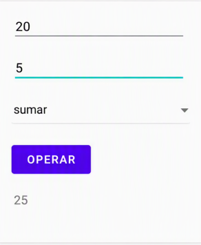
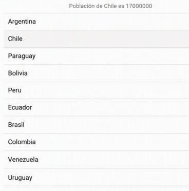
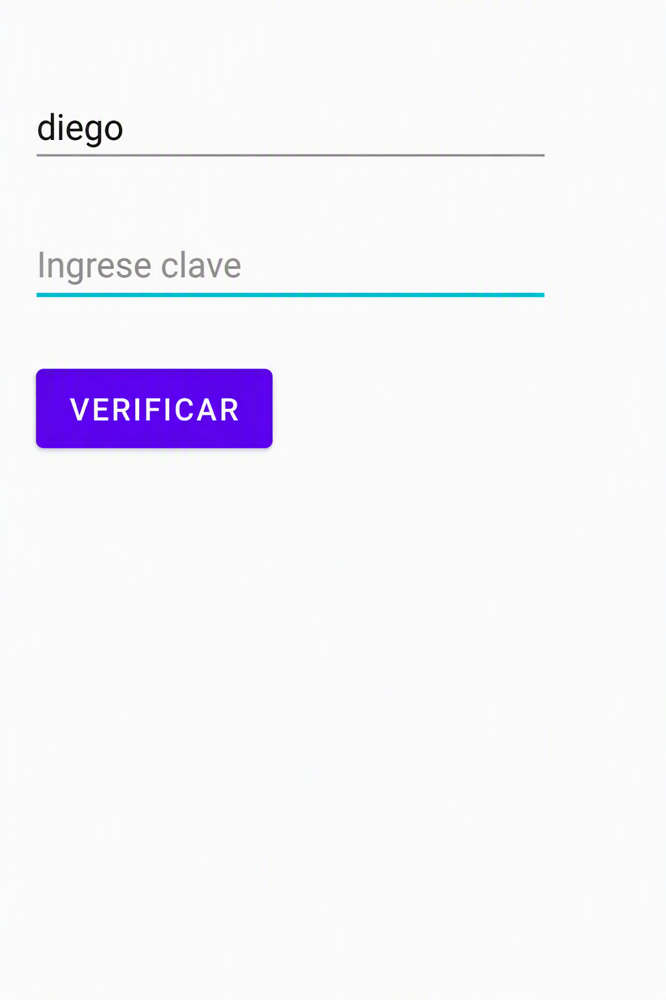

## Ejercicio 2
Construye un proyecto Kotlin Compose que permita elegir y realizar una de las dos operaciones:

## Ejercicio 3
Construye un proyecto Kotlin Compose que permita elegir y realizar una o dos operaciones:

## Ejercicio 4
Construye un proyecto Kotlin Compose que permita realizar una de las operaciones:

## Ejercicio 5
Construye un proyecto Kotlin Compose que permita seleccionar un PAIS de la lista y muestre la población actual en alguna parte de la interfaz [con una lista de 4-5 paises es suficiente]:

## Ejercicio 6
Construye un proyecto Kotlin Compose que al pulsar el botón verifique que los dos campos tienen algún dato y en este caso, se mostrará el número de caracteres de la clave en alguna parte de la pantalla. En caso contrario se deberá notificar el error. ¿Será posible mostrar los caracteres de la clave en formato ******** o similar?

## Ejercicio 7
- Mostrar una lista de nombres de alumnos usando LazyColumn.
- Mostrar una Card para cada alumno.

## Ejercicio 8
Aplicación "Catálogo de Videojuegos"
Crear un catálogo de videojuegos usando: Card() LazyColumn() Image() Text()
Requisitos:

    - Lista de videojuegos.
    - Imagen.
    - Título.
    - Género.
    - Toast al pulsar un elemento.
