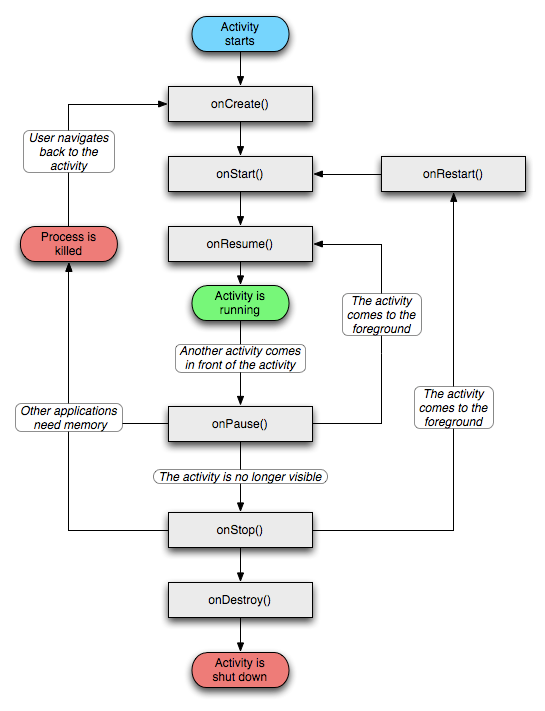

# Ciclo de vida de una aplicación Android
Toda Activity pasa por una serie de estados durante su existencia. El ciclo de vida es independiente de que utilicemos XML o Jetpack Compose.

Las principales fases son:

- onCreate()
- onStart()
- onResume()
- onPause()
- onStop()
- onDestroy()



## ¿Por qué es importante?
Permite:

- **Inicializar recursos.**

Cuando la Activity se crea por primera vez solemos cargar los elementos necesarios para que la aplicación funcione.

Por ejemplo:
    - Conectar con una base de datos.
    - Cargar una lista de alumnos.
    - Inicializar un RecyclerView.
    - Preparar una conexión a internet.
<!-- -->

- **Guardar estados.**

Cuando el usuario gira el móvil o cambia temporalmente a otra aplicación, la Activity puede destruirse y volver a crearse. Si no guardamos información, los datos introducidos podrían perderse.

Ejemplo: Un alumno está rellenando un formulario:

    Nombre: Mario
    Curso: DAM2

Gira el dispositivo. Los datos desaparecen, sin guardar el estado:

    Nombre:
    Curso: 

Ejemplo sencillo:

```kotlin
override fun onSaveInstanceState(outState: Bundle) {
    super.onSaveInstanceState(outState)
    outState.putString("nombre", txtNombre.text.toString()
    )
}
```

**Ejemplo real:**

Un usuario está escribiendo una incidencia en una app de mantenimiento y recibe una llamada telefónica.
Al volver a la aplicación quiere continuar exactamente donde estaba.

- **Recuperar información.**

No basta con guardar. También debemos recuperar esos datos cuando la Activity vuelva a crearse.

Ejemplo:
```kotlin
override fun onCreate(savedInstanceState: Bundle?) {
  super.onCreate(savedInstanceState)
  val nombre = savedInstanceState?.getString("nombre")
}
```
**Ejemplo real:**

Un usuario está viendo: **Alumno nº 145**
y gira el dispositivo. La aplicación debería seguir mostrando el mismo alumno y no volver al principio de la lista.

- **Liberar memoria cuando la aplicación deja de utilizarse.**

Los dispositivos móviles tienen memoria limitada.
Cuando una Activity deja de utilizarse debemos liberar los recursos que ya no necesitamos.

Ejemplos:
    - Cerrar conexiones con la base de datos.
    - Detener música.
    - Parar la cámara.
    - Cancelar peticiones de red.

Ejemplo:

```kotlin
override fun onDestroy() {
    super.onDestroy()
    conexion.close()
}
```

**Ejemplo real:**
Imagina una aplicación de Spotify. Si el usuario cierra la Activity y la aplicación sigue consumiendo recursos innecesariamente:
    - gastará batería
    - consumirá memoria
    - ralentizará el dispositivo


### Transiciones de estados más habituales

* **onCreate()** → **onStart()** → **onResume()** (la actividad está visible e interactiva)
* Si el usuario cambia de pantalla o la actividad ya no está en primer plano: **onPause()** → **onStop()**
* Si el usuario vuelve a la actividad, se llama nuevamente a **onRestart()** → **onStart()** → **onResume()**.
* Finalmente, si la actividad se cierra o se destruye: **onDestroy()**.
