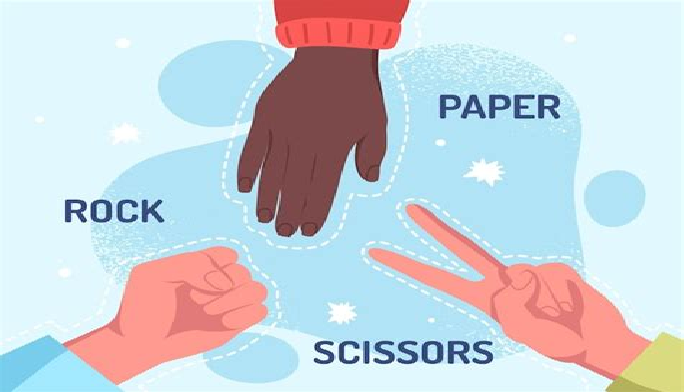

# PIEDRA - PAPEL - TIJERA

Implementa de forma básica el mítico Juego de Piedra, Papel o Tijera.

Básicamente el juego consistirá en lo siguiente (todo implementado en la misma PANTALLA):

1.- Elige mediante un campo de texto (¿numérico?) el número de rondas que quieres jugar en la partida.

2.- Al pulsar algún botón (por ejemplo "INICIAR PARTIDA") debes pintar tres imágenes distintas (PPT). Al pulsar en alguna de ellas, el sistema, que será tu
contrincante en el juego, elegirá aleatoriamente también uno de los tres elementos del juego (PPT).

3.- Cuando muestres el elemento (aleatorio) del sistema, podrán pasar dos cosas. O que se produzca empate, o que uno de los dos jugadores gane.

4.- En la misma actividad, debe haber un marcador para la partida, que se incrementará cuando el jugador o la máquina ganen o empaten.

5.- Cuando terminen el número de rondas elegidas al inicio debes mostrar un mensaje (¿TOAST?) con el ganador o ganadores en caso de empate final (Piensa que los 
jugadores pueden ser JUGADOR vs CPU, no complicarse más la vida de momento)

