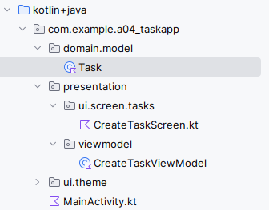

# Aplicación de Gestión de Tareas con MVVM y Jetpack Compose

## Introducción

En este proyecto se desarrolla una aplicación Android sencilla para la creación de tareas utilizando **Kotlin**, **Jetpack Compose** y el patrón arquitectónico **MVVM (Model - View - ViewModel)**.

El objetivo principal es mostrar cómo separar las responsabilidades de una aplicación moderna Android:

- **Model**: representa los datos de la aplicación.
- **View**: muestra la interfaz de usuario y recoge las acciones del usuario.
- **ViewModel**: almacena y gestiona el estado de la aplicación actuando como intermediario entre la vista y los datos.

La aplicación permite introducir el título y la descripción de una tarea mediante un formulario y gestionar el estado de los datos utilizando **StateFlow**. Además se incluye el **@Preview** para tener una visualización previa de la UI(sin necesidad de ejecución)

---

## Estructura del proyecto



---

## Arquitectura MVVM utilizada

La arquitectura utilizada sigue el patrón MVVM:

```text
┌─────────────┐
│    View     │
│ Compose UI  │
└──────┬──────┘
       │ Eventos
       ▼
┌─────────────┐
│ ViewModel   │
│ Estado UI   │
└──────┬──────┘
       │
       ▼
┌─────────────┐
│   Model     │
│    Task     │
└─────────────┘
```

### Flujo de funcionamiento

1. El usuario escribe información en los campos de texto.
2. La vista envía los cambios al ViewModel.
3. El ViewModel actualiza el estado mediante `StateFlow`.
4. Compose detecta los cambios y recompone automáticamente la interfaz.
5. Cuando se pulsa el botón **Guardar**, el ViewModel ejecuta la lógica necesaria para almacenar la tarea.

---

# 1. Task.kt

## ¿Qué hace?

Este fichero define el modelo de datos principal de la aplicación.

La clase `Task` representa una tarea que contiene:

- Un identificador (`id`)
- Un título (`title`)
- Una descripción (`description`)

## ¿Qué aporta al proyecto?

Forma parte de la capa **Model** de MVVM.

Su función es encapsular la información de una tarea y facilitar el intercambio de datos entre el ViewModel y la interfaz de usuario.

Además, al ser una `data class`, Kotlin genera automáticamente:

- `equals()`
- `hashCode()`
- `toString()`
- `copy()`

Esta última función resulta especialmente útil para actualizar datos de forma inmutable.

## Código

```kotlin
package com.example.a04_taskapp.domain.model

data class Task(
    val id: Int,
    val title: String,
    val description: String
)
```

---

# 2. CreateTaskViewModel.kt

## ¿Qué hace?

Este fichero implementa el ViewModel encargado de gestionar el estado de la pantalla de creación de tareas.

Contiene:

- El objeto `Task` actual.
- Los métodos para modificar el título.
- Los métodos para modificar la descripción.
- El mecanismo para controlar el guardado de la tarea.

## ¿Qué aporta al proyecto?

Representa la capa intermedia entre la interfaz y los datos.

Gracias al ViewModel:

- La lógica de negocio queda separada de la interfaz.
- Los datos sobreviven a cambios de configuración.
- La interfaz solamente observa el estado.
- Se respeta la arquitectura MVVM.

### Uso de StateFlow

Se utiliza:

```kotlin
MutableStateFlow
```

para almacenar el estado mutable.

Y:

```kotlin
StateFlow
```

para exponer una versión de solo lectura a la interfaz.

De esta forma la UI puede leer los datos, pero no modificarlos directamente.

## Código

```kotlin
package com.example.a04_taskapp.presentation.viewmodel

import android.widget.Toast
import androidx.lifecycle.ViewModel
import com.example.a04_taskapp.domain.model.Task
import kotlinx.coroutines.flow.MutableStateFlow
import kotlinx.coroutines.flow.StateFlow

class CreateTaskViewModel : ViewModel() {

    private val _task = MutableStateFlow<Task>(
        Task(0, "", "")
    )

    val task: StateFlow<Task> = _task

    fun setTitle(title: String) {
        _task.value = _task.value.copy(title = title)
    }

    fun setDescription(description: String) {
        _task.value = _task.value.copy(description = description)
    }

    private val _showToast = MutableStateFlow(false)

    val showToast: StateFlow<Boolean> = _showToast

    fun onToastShown() {
        _showToast.value = false
    }

    fun save() {

        // TODO Aquí va la lógica para guardar la tarea
        // Veremos qué se hace en el próximo tema

        //Toast.makeText(this, "Operación realizada", Toast.LENGTH_SHORT ).show()

        _showToast.value = true
    }
}
```

---

# 3. CreateTaskScreen.kt

## ¿Qué hace?

Este fichero contiene la interfaz de usuario construida con Jetpack Compose.

La pantalla muestra:

- Un título.
- Un campo para introducir el nombre de la tarea.
- Un campo para la descripción.
- Un botón para guardar.

## ¿Qué aporta al proyecto?

Representa la capa **View** dentro de MVVM.

Su responsabilidad consiste únicamente en:

- Mostrar información.
- Capturar acciones del usuario.
- Notificar eventos al ViewModel.

### Función CreateTaskScreen()

Es la encargada de:

1. Obtener una instancia del ViewModel.
2. Observar el estado mediante `collectAsState()`.
3. Enviar los datos a `CreateTaskContent()`.

### Función CreateTaskContent()

Contiene la interfaz visual:

- `Scaffold`
- `Column`
- `TextField`
- `Button`
- `Spacer`

Todos los cambios del usuario se comunican mediante callbacks.

### Preview

La función `CreateTaskScreenPreview()` permite visualizar la pantalla desde Android Studio sin necesidad de ejecutar la aplicación.

## Código

```kotlin
package com.example.a04_taskapp.presentation.ui.screen.tasks

import android.widget.Toast
import androidx.compose.foundation.layout.Column
import androidx.compose.foundation.layout.Spacer
import androidx.compose.foundation.layout.fillMaxWidth
import androidx.compose.foundation.layout.height
import androidx.compose.foundation.layout.padding
import androidx.compose.material3.Button
import androidx.compose.material3.Scaffold
import androidx.compose.material3.Text
import androidx.compose.material3.TextField
import androidx.compose.runtime.Composable
import androidx.compose.runtime.collectAsState
import androidx.compose.ui.Alignment
import androidx.compose.ui.Modifier
import androidx.compose.ui.unit.dp
import androidx.lifecycle.viewmodel.compose.viewModel
import androidx.compose.runtime.getValue
import androidx.compose.ui.platform.LocalContext
import androidx.compose.ui.text.style.TextAlign
import androidx.compose.ui.tooling.preview.Preview
import androidx.compose.ui.unit.sp
import com.example.a04_taskapp.domain.model.Task
import com.example.a04_taskapp.presentation.viewmodel.CreateTaskViewModel

@Composable
fun CreateTaskScreen(
    createTaskViewModel: CreateTaskViewModel = viewModel()
) {

    val task by createTaskViewModel.task.collectAsState()

    CreateTaskContent(
        task = task,
        onTitleChange = createTaskViewModel::setTitle,
        onDescriptionChange = createTaskViewModel::setDescription,
        onSaveClick = createTaskViewModel::save
    )
}

@Composable
fun CreateTaskContent(
    task: Task,
    onTitleChange: (String) -> Unit,
    onDescriptionChange: (String) -> Unit,
    onSaveClick: () -> Unit
) {

    Scaffold(
        topBar = {
            Text(
                text = "Crear tarea",
                modifier = Modifier
                    .fillMaxWidth()
                    .padding(top = 126.dp),
                textAlign = TextAlign.Center,
                fontSize = 24.sp
            )
        }
    ) { innerPadding ->

        Column(
            modifier = Modifier.padding(innerPadding)
        ) {

            TextField(
                modifier = Modifier.fillMaxWidth(),
                value = task.title,
                label = { Text("Título") },
                onValueChange = onTitleChange
            )

            Spacer(modifier = Modifier.height(16.dp))

            TextField(
                modifier = Modifier.fillMaxWidth(),
                value = task.description,
                label = { Text("Descripción") },
                onValueChange = onDescriptionChange
            )

            Spacer(modifier = Modifier.height(16.dp))

            Button(
                modifier = Modifier.align(Alignment.CenterHorizontally),
                onClick = onSaveClick
            ) {
                Text("Guardar")
            }
        }
    }
}

@Preview(showBackground = true)
@Composable
fun CreateTaskScreenPreview() {

    CreateTaskContent(
        task = Task(
            id = 0,
            title = "Preparar examen",
            description = "Repasar Compose y ViewModel"
        ),
        onTitleChange = {},
        onDescriptionChange = {},
        onSaveClick = {}
    )
}
```

---

# 4. MainActivity.kt

## ¿Qué hace?

Es el punto de entrada de la aplicación Android.

Android ejecuta esta actividad cuando el usuario abre la aplicación.

## ¿Qué aporta al proyecto?

Su responsabilidad es inicializar Compose y mostrar la pantalla principal.

La actividad mantiene una implementación muy limpia porque toda la lógica se encuentra en el ViewModel y toda la interfaz en Compose.

### Proceso de ejecución

1. Se inicia la actividad.
2. Se configura Compose mediante `setContent`.
3. Se obtiene una instancia del ViewModel.
4. Se muestra `CreateTaskScreen()`.
5. La pantalla queda vinculada al estado del ViewModel.

## Código

```kotlin
package com.example.a04_taskapp

import android.os.Bundle
import androidx.activity.ComponentActivity
import androidx.activity.compose.setContent
import androidx.activity.enableEdgeToEdge
import androidx.compose.material3.Text
import androidx.compose.runtime.Composable
import androidx.compose.ui.Modifier
import androidx.compose.ui.tooling.preview.Preview
import androidx.lifecycle.viewmodel.compose.viewModel
import com.example.a04_taskapp.presentation.ui.screen.tasks.CreateTaskScreen
import com.example.a04_taskapp.presentation.viewmodel.CreateTaskViewModel
import com.example.a04_taskapp.ui.theme._04_TaskAppTheme

class MainActivity : ComponentActivity() {

    override fun onCreate(savedInstanceState: Bundle?) {
        super.onCreate(savedInstanceState)

        enableEdgeToEdge()

        setContent {

            val vm: CreateTaskViewModel = viewModel()en(vm)
        }
    }
}

@Composable
fun Greeting(
    name: String,
    modifier: Modifier = Modifier
) {
    Text(
        text = "Hello $name!",
        modifier = modifier
    )
}

@Preview(showBackground = true)
@Composable
fun GreetingPreview() {
    _04_TaskAppTheme {
        Greeting("Android")
    }
}
```

---

# Conclusiones

Este proyecto constituye un ejemplo sencillo pero muy representativo de una aplicación Android moderna utilizando **Jetpack Compose** y el patrón **MVVM**.

Cada capa tiene una responsabilidad claramente definida:

| Componente | Responsabilidad |
|------------|----------------|
| Task | Modelar los datos de la tarea |
| CreateTaskViewModel | Gestionar el estado y la lógica de negocio |
| CreateTaskScreen | Mostrar la interfaz y recoger acciones del usuario |
| MainActivity | Iniciar la aplicación |

Gracias a esta separación se consigue un código más limpio, mantenible y escalable, facilitando la incorporación futura de nuevas funcionalidades como almacenamiento en base de datos, navegación entre pantallas o integración con servicios web.
